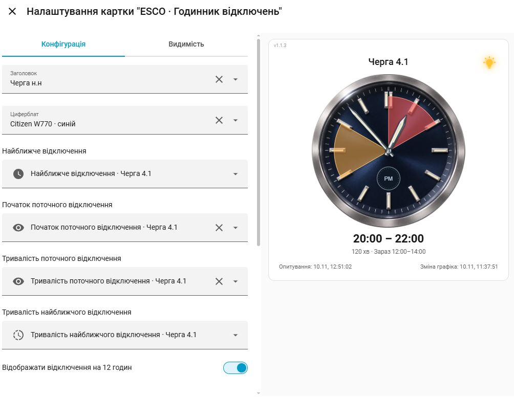

# ESCO Outage Clock

Картка Home Assistant зі стрілочним годинником та секторами графіка відключень електроенергії. Поточна версія — **1.5.2**.



## Можливості

- Три оформлення за мотивами Citizen W770, Rolex Submariner та Omega Seamaster.
- Поточне відключення червоним, інші періоди — жовтим; усередині секторів позначено AM/PM.
- Повний графік дня або найближчі 12 годин, включно з переходом через північ.
- Очищення минулих періодів та приховування майбутніх секторів, що накладаються на поточний час AM/PM.
- Автоматичний вибір сенсорів за чергою, ручне налаштування та кілька карток різних черг.
- Лампа фактичної наявності електроенергії за окремим датчиком on/off.
- Час останнього опитування та зміни графіка. Український інтерфейс.

## Дані та інтеграція

Потрібна встановлена інтеграція **ESCO Outages**.
Цей репозиторій містить файли картки. Автоматичний вибір потребує атрибутів `line` та `esco_field` у сенсорах інтеграції.
Для кожної потрібної черги спочатку додайте окремий екземпляр ESCO Outages.

## Встановлення через Marketplace або HACS

Додайте `https://github.com/tgps-robo/esco-outage-clock` як користувацький репозиторій типу **Dashboard / Lovelace** та встановіть його.

JS і всі три PNG розташовані разом у `dist`. Marketplace встановлює ресурс за адресою
`/local/community/esco-outage-clock/esco-outage-clock.js` із параметром версії.
Перевірте створений ресурс у налаштуваннях панелей і оновіть сторінку браузера.
Якщо раніше використовували ручне встановлення, приберіть старий ресурс `/local/esco-outage-clock.js` перед завантаженням нового, щоб модуль завантажувався один раз.

## Ручне встановлення

1. Завантажте всі чотири файли з `dist` у `/config/www/`.
2. Додайте ресурс `/local/esco-outage-clock.js?v=1.5.2` типу **Модуль JavaScript**.
3. Оновіть сторінку через Ctrl+F5.
4. Додайте картку **ESCO · Годинник відключень**, виберіть чергу та параметри.

Якщо папку `www` створено вперше, перезапустіть Home Assistant.

## Приклад YAML

```yaml
type: custom:esco-outage-clock
line: "4.1"
title_mode: line
dial: citizen
show_12_hours: true
clear_past_periods: true
show_last_poll: true
show_schedule_updated: true
show_real_outage: false
```

## Параметри

| Ключ | Призначення | Типове значення |
| --- | --- | --- |
| `line` | Черга `1.1`–`6.2` або `manual` для ручного вибору | Ручний вибір |
| `title_mode` | `next` — Найближче відключення, `line` — Черга н.н | `next` |
| `dial` | `citizen`, `rolex`, `omega` | `citizen` |
| `start_entity` | Сенсор початку найближчого відключення | Вибір вручну або за чергою |
| `duration_entity` | Сенсор тривалості найближчого відключення | Вибір вручну або за чергою |
| `current_start_entity` | Сенсор початку поточного відключення | Вибір вручну або за чергою |
| `current_duration_entity` | Сенсор тривалості поточного відключення | Вибір вручну або за чергою |
| `show_12_hours` | Показувати поточні та наступні інтервали в межах 12 годин | `false` |
| `clear_past_periods` | Приховувати завершені періоди | `false` |
| `show_real_outage` | Показувати лампу фактичного живлення | `false` |
| `power_entity` | Сутність зі станами `on`/`off` для лампи | Не задано |
| `invert_power` | Інвертувати значення датчика живлення | `false` |
| `show_last_poll` | Показувати останнє успішне опитування внизу ліворуч | `false` |
| `show_schedule_updated` | Показувати поле `dt` графіка внизу праворуч | `false` |

Годинник використовує часовий пояс Europe/Kyiv. Для інтервалів завтра потрібен оновлений сервер API та опублікований завтрашній графік.
